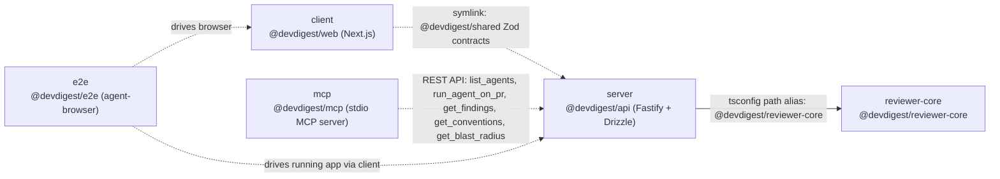

# Dependency Report — 2026-10-12

## 1. Overview

| Package | Manager | node_modules size | Direct deps | Dev deps | Critical | High | Moderate | Low |
|---|---|---|---|---|---|---|---|---|
| server | pnpm | 234M | 22 | 8 | 6 | 32 | 23 | 5 |
| client | pnpm | 620M | 11 | 12 | 5 | 15 | 23 | 5 |
| reviewer-core | npm | 156M | 2 | 4 | 2 | 5 | 3 | 0 |
| e2e | npm | 37M | 0 | 3 | 0 | 0 | 0 | 1 |
| mcp | pnpm | 209M | 2 | 5 | 3 | 1 | 5 | 0 |

**Total disk size across all `node_modules`:** 1256M (~1.23 GB)
**Total open vulnerabilities:** 134 (16 critical, 53 high, 54 moderate, 11 low)

## 2. Component Dependency Diagram

`server` is the hub: `reviewer-core` is pulled in at compile time via a TypeScript path alias (not an npm dependency), `client` shares server's Zod contracts through a symlinked `src/vendor/shared` directory (no second copy), and `mcp` never imports server code — it only calls server's HTTP API. `e2e` is a pure consumer that drives the browser against `client`, which in turn talks to `server`.

## 3. Per-Package Breakdown

### server (`@devdigest/api`)

**Top heaviest dependencies:**
| Package | Size |
|---|---|
| typescript@5.9.3 | 23M |
| js-tiktoken@1.0.21 | 21M |
| drizzle-orm@0.38.4 | 13M |
| @esbuild/darwin-arm64@0.28.0 | 10M |
| esbuild@0.21.5 | 9.5M |
| @esbuild/darwin-arm64@0.19.12 | 9.3M |
| @esbuild/darwin-arm64@0.18.20 | 9.1M |
| openai@4.104.0 | 7.4M |
| drizzle-kit@0.30.6 | 7.4M |
| @ast-grep/napi-darwin-arm64@0.43.0 | 6.7M |

**Vulnerabilities:**
| Package | Severity | Issue | Vulnerable range | Fix |
|---|---|---|---|---|
| shell-quote | critical | `quote()` command injection via line terminator after a `{ comment }` token | >=1.8.4 <1.11.0 | >=1.11.0 |
| simple-git (`@simple-git/argv-parser`) | critical | `VISUAL` editor env var omitted from unsafe editor detection | <2.0.1 | >=2.0.1 |
| simple-git | critical | unsafe-operation guard does not block trailer command configuration | >=3.15.0 <4.0.1 | >=4.0.1 |
| tinypool | critical | Prototype Pollution gadget in worker options → RCE | <=2.1.0 | >=2.1.1 |
| tinypool | critical | Prototype Pollution gadget → RCE in `run()` options | <2.1.2 | >=2.1.2 |
| vitest | critical | arbitrary file read/execute while Vitest UI server listening | <3.2.6 | >=3.2.6 |
| drizzle-orm | high | SQL injection via improperly escaped SQL identifiers | <0.45.2 | >=0.45.2 |
| fastify | high | request body replacement via async validation result collision | <5.12.2 | >=5.12.2 |
| fastify | high | authentication bypass via malformed URLs reaching encapsulated not-found handlers | >=4.0.0 <5.12.2 | >=5.12.2 |
| fastify | high | request validation bypass via skipped boolean false schemas | <5.12.2 | >=5.12.2 |
| fastify | high | header validation bypass via incomplete schema case normalization | <5.12.2 | >=5.12.2 |
| @fastify/busboy | high | DoS via prototype-named multipart part header | >=1.0.0 <3.2.1 | >=3.2.1 |
| simple-git | high | command execution through unblocked Git configuration includes | <=3.36.0 | >=4.0.0 |
| simple-git | high | unsafe-operations plugin bypass via long-option abbreviation → command execution | <=3.36.0 | >=4.0.0 |
| undici | high | Unbounded Memory Consumption in WebSocket permessage-deflate decompression | <6.24.0 | >=6.24.0 |
| undici | high | Unhandled Exception via invalid `server_max_window_bits` validation | <6.24.0 | >=6.24.0 |
| undici | high | WebSocket DoS via fragment count bypass | <6.27.0 | >=6.27.0 |
| form-data | high | CRLF injection via unescaped multipart field names/filenames | >=4.0.0 <4.0.6 | >=4.0.6 |
| vite | high | `server.fs.deny` bypass on Windows alternate paths | <=6.4.2 | >=6.4.3 |
| brace-expansion | high | DoS via several distinct exponential/recursive expansion bugs (4 advisories) | >=2.0.0 <2.1.7 (varies) | >=2.1.7 |
| fast-uri | high | SSRF / host confusion via multiple normalization bugs (6 advisories) | <3.1.8 (varies) | >=3.1.8 |
| find-my-way | high | DDoS with HTTP/2 | <=9.6.0 | >=9.7.0 |
| postcss | high | Path traversal / arbitrary `.map` file disclosure | <=8.5.17 | >=8.5.18 |
| nanoid | high | non-secure/custom generators loop indefinitely | <3.3.18 (varies) | >=3.3.18 |
| @grpc/grpc-js | high | `getAuthContext` can return unauthorized certs as authorized | >=1.14.0 <1.14.5 | >=1.14.5 |
| source-map-js | high | event-loop DoS via indexed source-map section offsets | >=1.0.0 <1.2.2 | >=1.2.2 |
| esbuild | moderate | dev server allows any website to send requests and read responses | <=0.24.2 | >=0.25.0 |
| undici | moderate | multiple: decompression DoS, request smuggling, CRLF injection, cookie/header issues (7 advisories) | <6.28.0 (varies) | >=6.28.0 |
| vite | moderate | path traversal in optimized deps `.map` handling; NTLMv2 hash disclosure | <=6.4.2 | >=6.4.3 |
| uuid | moderate | missing buffer bounds check in v3/v5/v6 when buf is provided | <11.1.1 | >=11.1.1 |
| protobufjs | moderate | schema-derived names shadow runtime-significant properties; infinite loop DoS | <=7.6.4 | >=7.6.5 |
| postcss | moderate | incomplete fix of prior sourceMappingURL disclosure | <=8.5.22 | >=8.5.23 |
| fastify | moderate | schema validation bypass; X-Forwarded-* spoofing; HTTP/2 trailer DoS | <5.12.5 | >=5.12.5 |
| vitest / @vitest/mocker | moderate | path traversal / arbitrary file read via Redirect Mock | >=2.1.0 <4.1.11 | >=4.1.11 |
| @fastify/busboy | moderate | CRLF injection via multipart filename/name | <3.2.2 | >=3.2.2 |
| fast-copy | moderate | stack exhaustion on deeply-nested values | >=4.0.0 <4.1.0 | >=4.1.0 |
| esbuild | low | arbitrary file read on Windows dev server | >=0.27.3 <0.28.1 | >=0.28.1 |
| undici | low | Set-Cookie SameSite downgrade; response queue poisoning; response splitting (3 advisories) | <6.28.1 (varies) | >=6.28.1 |
| @grpc/grpc-js | low | server leaks error messages to client in status messages | >=1.14.0 <1.14.5 | >=1.14.5 |

### client (`@devdigest/web`)

**Top heaviest dependencies:**
| Package | Size |
|---|---|
| next@15.5.19 | 152M |
| @next/swc-darwin-arm64@15.5.19 | 124M |
| mermaid@11.15.0 | 75M |
| lucide-react@0.469.0 | 36M |
| typescript@5.9.3 | 23M |
| @img/sharp-libvips-darwin-arm64@1.2.4 | 15M |
| es-toolkit@1.47.0 | 13M |
| @mermaid-js/parser@1.1.1 | 11M |
| esbuild@0.21.5 | 9.5M |
| cytoscape-fcose@2.2.0 | 8.4M |

**Vulnerabilities:**
| Package | Severity | Issue | Vulnerable range | Fix |
|---|---|---|---|---|
| next | critical | Unauthenticated Remote Code Execution on Windows-hosted servers | >=13.4.0 <15.5.24 | >=15.5.24 |
| next | critical | Unauthenticated RCE in Image Optimization API via AVIF files | >=10.0.0 <15.5.24 | >=15.5.24 |
| vitest | critical | arbitrary file read/execute while Vitest UI server listening | <3.2.6 | >=3.2.6 |
| tinypool | critical | Prototype Pollution gadget → RCE (2 advisories) | <2.1.2 | >=2.1.2 |
| next | high | DoS in App Router via Server Actions | >=13.0.0 <15.5.21 | >=15.5.21 |
| next | high | SSRF in Server Actions on custom servers | >=14.1.1 <15.5.21 | >=15.5.21 |
| next | high | SSRF in rewrites via attacker-controlled destination hostname | >=12.0.0 <15.5.21 | >=15.5.21 |
| sharp | high | inherited libvips/libheif/librsvg CVEs (3 advisories) | <0.35.5 (varies) | >=0.35.5 |
| form-data | high | CRLF injection via unescaped multipart field names/filenames | >=4.0.0 <4.0.6 | >=4.0.6 |
| vite | high | `server.fs.deny` bypass on Windows alternate paths | <=6.4.2 | >=6.4.3 |
| postcss | high | path traversal / arbitrary `.map` file disclosure | <=8.5.17 | >=8.5.18 |
| nanoid | high | non-secure/custom generators loop indefinitely (2 advisories) | <3.3.18 | >=3.3.18 |
| browserslist | high | unbounded memory growth (OOM); crash via untrusted stats JSON | <=4.28.6 | >=4.28.7 |
| source-map-js | high | event-loop DoS via indexed source-map section offsets | >=1.0.0 <1.2.2 | >=1.2.2 |
| next | moderate | cache confusion, unbounded Server Action payload, SVG Image-Opt DoS, internal endpoint disclosure, SSG/ISR cache poisoning (7 advisories) | varies, all <15.5.27 | >=15.5.27 |
| esbuild | moderate | dev server request/response leak | <=0.24.2 | >=0.25.0 |
| vite | moderate | path traversal in optimized deps; NTLMv2 hash disclosure | <=6.4.2 | >=6.4.3 |
| postcss | moderate | XSS via unescaped `</style>`; incomplete sourceMappingURL fix | <8.5.10 / <=8.5.22 | >=8.5.10 / >=8.5.23 |
| next-intl | moderate | open redirect; prototype pollution via translation catalog keys | <=4.9.1 | >=4.9.2 |
| dompurify | moderate | `ALLOWED_ATTR` pollution bypass; IN_PLACE hook XSS | <=3.4.12 | >=3.4.13 |
| mermaid | moderate | CSS injection, architecture-diagram prototype pollution, XY chart / radar diagram DoS (4 advisories) | <11.16.1 | >=11.16.1 |
| vitest / @vitest/mocker | moderate | path traversal / arbitrary file read via Redirect Mock | >=2.1.0 <4.1.11 | >=4.1.11 |
| baseline-browser-mapping | moderate | process termination on invalid input → DoS | >=2.0.0 <2.11.0 | >=2.11.0 |
| mermaid | low | configuration API prototype pollution | <11.16.1 | >=11.16.1 |
| dompurify | low | Trusted Types policy survives `clearConfig()`; custom-element handling bypass; IN_PLACE rawtext XSS (3 advisories) | varies | varies, latest >=3.4.16 |
| katex | low | existing prototype pollution bypasses trust restrictions | >=0.11.0 <0.18.2 | >=0.18.2 |

### reviewer-core (`@devdigest/reviewer-core`)

**Top heaviest dependencies:**
| Package | Size |
|---|---|
| typescript@5.9.3 | 23M |
| @esbuild/darwin-arm64@0.28.2 | 10M |
| @esbuild/darwin-arm64@0.21.5 | 9.4M |
| openai@4.104.0 | 7.4M |
| zod@3.25.76 | 5.0M |
| vite@5.4.21 | 3.2M |
| rollup@4.63.4 | 2.8M |
| @types/node@22.20.4 | 2.5M |
| @types/node@18.19.130 | 2.1M |
| vitest@2.1.9 | 1.9M |

**Vulnerabilities:**
| Package | Severity | Issue | Vulnerable range | Fix |
|---|---|---|---|---|
| tinypool | critical | Prototype Pollution gadget → RCE (via vitest) | <=2.1.1 | bump vitest → 4.1.11 (major) |
| vitest | critical | arbitrary file read/execute via UI server + `@vitest/mocker` chain | <=4.1.10 | bump vitest → 4.1.11 (major) |
| form-data | high | CRLF injection via unescaped multipart field names/filenames | 4.0.0 - 4.0.5 | `npm audit fix` (simple bump) |
| nanoid | high | non-secure/custom generators loop indefinitely | <=3.3.17 | `npm audit fix` (simple bump) |
| postcss | high | sourceMappingURL path traversal (2 advisories) | <=8.5.22 | `npm audit fix` (simple bump) |
| source-map-js | high | event-loop DoS via indexed source-map offsets | 1.0.0 - 1.2.1 | `npm audit fix` (simple bump) |
| vite | high | path traversal / `server.fs.deny` bypass + esbuild chain | <=6.4.2 | bump vitest → 4.1.11 (major) |
| @vitest/mocker | moderate | path traversal / arbitrary file read via Redirect Mock | <=4.1.10 | bump vitest → 4.1.11 (major) |
| esbuild | moderate | dev server request/response leak (2 advisories) | <=0.24.2 \|\| 0.27.3-0.28.0 | bump vitest → 4.1.11 (major) |
| vite-node | moderate | inherits vite issue | <=2.2.0-beta.2 | bump vitest → 4.1.11 (major) |

### e2e (`@devdigest/e2e`)

**Top heaviest dependencies:**
| Package | Size |
|---|---|
| typescript | 23M |
| esbuild | 10M |
| darwin-arm64 | 10M |
| node (types) | 2.5M |
| @types | 2.5M |
| tsx | 664K |
| undici-types | 196K |
| fsevents | 180K |
| @esbuild | 8.0K |

**Vulnerabilities:**
| Package | Severity | Issue | Vulnerable range | Fix |
|---|---|---|---|---|
| esbuild | low | arbitrary file read on Windows dev server | 0.27.3 - 0.28.0 | `npm audit fix` (simple bump, fixAvailable: true) |

### mcp (`@devdigest/mcp`)

**Top heaviest dependencies:**
| Package | Size |
|---|---|
| typescript@5.9.3 | 23M |
| js-tiktoken@1.0.21 | 21M |
| @esbuild/darwin-arm64@0.28.2 | 10M |
| @esbuild/darwin-arm64@0.21.5 | 9.4M |
| @modelcontextprotocol/sdk@1.32.1 | 6.1M |
| zod@3.25.76 | 5.0M |
| vite@5.4.21 | 3.2M |
| rollup@4.64.5 | 2.9M |
| hono@4.13.13 | 2.8M |
| @types/node@22.20.5 | 2.5M |

**Vulnerabilities:**
| Package | Severity | Issue | Vulnerable range | Fix |
|---|---|---|---|---|
| tinypool | critical | Prototype Pollution gadget → RCE (2 advisories, via vitest) | <2.1.2 | `pnpm` bump vitest → patched range |
| vitest | critical | arbitrary file read/execute while Vitest UI server listening | <3.2.6 | bump vitest |
| vite | high | `server.fs.deny` bypass on Windows alternate paths | <=6.4.2 | bump vite → >=6.4.3 |
| esbuild | moderate | dev server request/response leak | <=0.24.2 | bump esbuild → >=0.25.0 |
| vite | moderate | path traversal in optimized deps; NTLMv2 hash disclosure | <=6.4.2 | bump vite → >=6.4.3 |
| vitest / @vitest/mocker | moderate | path traversal / arbitrary file read via Redirect Mock | >=2.1.0 <4.1.11 | bump vitest → >=4.1.11 |

## 4. Prioritized Recommendations

1. **[CRITICAL]** `server`, `client`, `mcp` — `tinypool` (via `vitest`): Prototype Pollution gadget in worker/`run()` options leads to Remote Code Execution. Fix: bump `vitest` to `>=4.1.11` in each package (`cd server && pnpm up vitest@latest`; same for `client` and `mcp`). This is a dev-only dependency (test runner), so exposure is limited to local/CI dev environments, but RCE via a test-time dependency can still compromise a developer machine or CI runner. Impact if ignored: an attacker who can influence worker options (e.g. via a malicious test fixture or compromised transitive package) gets code execution during `pnpm test`/CI.

2. **[CRITICAL]** `server`, `client`, `reviewer-core`, `mcp` — `vitest`: "When Vitest UI server is listening, arbitrary file can be read and executed." Fix: bump `vitest` to `>=3.2.6` (ideally straight to `>=4.1.11` to also clear the `tinypool`/`@vitest/mocker` chain) in all four packages. For `reviewer-core` this is `isSemVerMajor: true` (vitest 2.x → 4.x) so budget time to re-run the full test suite after the bump. Impact if ignored: if the Vitest UI server is ever started (even briefly, locally), any local network request can read/execute arbitrary files.

3. **[CRITICAL]** `server` — `simple-git`: two advisories — unsafe editor detection omits `VISUAL` env var, and the unsafe-operation guard doesn't block trailer command configuration, both enabling command execution. Fix: `cd server && pnpm up simple-git@^4.0.1`. Impact if ignored: if `server`'s code path that shells out to git (repo-intel indexer) ever processes attacker-influenced repo content/config, this is a command-execution primitive.

4. **[CRITICAL]** `server` — `shell-quote`: `quote()` command injection via a line terminator in a token after a `{ comment }` token. Fix: `cd server && pnpm up shell-quote@^1.11.0`. Impact if ignored: command injection if any code path builds shell commands from repo-indexer input using `shell-quote`.

5. **[CRITICAL]** `client` — `next`: two advisories — unauthenticated RCE on Windows-hosted servers, and unauthenticated RCE in the Image Optimization API via AVIF files. Fix: `cd client && pnpm up next@^15.5.24` (or latest 15.5.x). Impact if ignored: full unauthenticated RCE against the Next.js server if deployed on Windows or if the Image Optimization API processes untrusted AVIF uploads.

6. **[HIGH]** `server` — `drizzle-orm`: SQL injection via improperly escaped SQL identifiers. Fix: `cd server && pnpm up drizzle-orm@^0.45.2`. Impact if ignored: SQL injection risk anywhere dynamic identifiers (table/column names) are built from user input.

7. **[HIGH]** `server` — `fastify`: five advisories in the 5.8.3–5.12.1 range — request body replacement via async validation collision, auth bypass via malformed URLs reaching not-found handlers, request validation bypass via skipped boolean-false schemas, header validation bypass via case normalization. Fix: `cd server && pnpm up fastify@^5.12.5` (clears all five plus the two moderate ones in section 3). This is a same-day version bump, no major jump needed. Impact if ignored: several routes' Zod validation (mandated by `CLAUDE.md`) could be bypassed at the Fastify layer before it ever reaches your schema.

8. **[HIGH]** `server`, `client` (transitively via Next/Vite build tooling) — `fast-uri`: six distinct SSRF/host-confusion advisories (percent-encoding, backslash authority, IDN canonicalization, port injection). Fix: `cd server && pnpm up fast-uri@^3.1.8` (and allow it to resolve transitively in `client`). Impact if ignored: SSRF primitives wherever `fast-uri`-based URL validation (via `ajv`/Fastify schema tooling) gates outbound or redirect URLs.

9. **[HIGH]** `server` — `@grpc/grpc-js`: `getAuthContext` can return unauthorized certificates as authorized. Fix: `cd server && pnpm up @grpc/grpc-js@^1.14.5`. Impact if ignored: if any gRPC-based auth path exists (likely transitive via an LLM/OpenTelemetry SDK), unauthorized certs could be treated as authenticated.

10. **[HIGH]** `client` — `next` (6 more High/Critical-adjacent advisories: DoS via Server Actions, SSRF in Server Actions on custom servers, SSRF in rewrites via attacker-controlled hostname) are all cleared by the same `next@^15.5.24` bump in item 5 — do it once, get all of them.

11. **[HIGH]** `client` — `sharp`: three advisories, all libvips/libheif/librsvg CVEs inherited from native image libraries. Fix: `cd client && pnpm up sharp@^0.35.5`. Impact if ignored: image-processing vulnerabilities (memory corruption / potential RCE) in Next.js Image Optimization pipeline if it handles untrusted uploads.

12. **[HIGH]** All packages with `undici`/`form-data`/`brace-expansion`/`postcss`/`source-map-js`/`nanoid` advisories — these are almost all simple patch-level bumps with `fixAvailable: true` (no major version jump). Fix: run `cd server && pnpm audit fix` and `cd client && pnpm audit fix`, then re-run the audit script to confirm what's left (pnpm's audit fix is conservative and may not auto-resolve everything — check the diff). Impact if ignored: a long tail of DoS/smuggling/injection bugs in HTTP, build-tooling, and glob-matching code paths that are individually lower severity but numerous.

13. **[MODERATE]** `client` — `mermaid`: four advisories (CSS injection, architecture-diagram prototype pollution, XY chart/radar DoS). Fix: `cd client && pnpm up mermaid@^11.16.1`. Impact if ignored: client renders diagrams from LLM-generated or user-supplied Mermaid source (used for review visualizations) — CSS injection/DoS is plausible if that content is ever less-than-fully-trusted.

14. **[MODERATE]** `client` — `dompurify`: three moderate/low advisories around `ALLOWED_ATTR` pollution and `IN_PLACE` hook bypass leading to XSS. Fix: `cd client && pnpm up dompurify@^3.4.16`. Impact if ignored: sanitization bypass could allow stored/reflected XSS wherever DOMPurify sanitizes LLM output or user content before rendering.

15. **[MODERATE]** `client` — `next-intl`: open redirect and prototype pollution via translation catalog keys. Fix: `cd client && pnpm up next-intl@^4.9.2`. Impact if ignored: open redirect is a phishing vector; prototype pollution could affect app-wide object behavior if catalogs are ever user-influenced.

16. **[MODERATE]** `client` — `browserslist`: unbounded memory growth and crash/prototype-write via untrusted stats JSON. Fix: `cd client && pnpm up browserslist@^4.28.7`. Build-time only; low real-world exposure unless `browserslist-stats.json` is ever sourced from untrusted input.

17. **[LOW]** `e2e` — `esbuild`: arbitrary file read on Windows dev server, range `0.27.3–0.28.0`. Fix: `cd e2e && npm audit fix` (flagged `fixAvailable: true`, no major bump). Lowest-severity, dev-only, smallest package — quick cleanup item.

**Size note (secondary):** `client` is by far the heaviest package at 620M, driven almost entirely by `next` (152M) and its platform-specific SWC binary (124M) plus `mermaid` (75M) — together ~57% of `client`'s footprint. This is expected for a Next.js + Mermaid-rendering app and isn't itself an action item; it's listed here only as context, ranked below all vulnerability items per the report's security-first ordering.

## 5. Notes

- All five packages' `pnpm`/`npm audit` commands completed successfully; no registry timeouts or errors were encountered, so this report reflects a complete scan, not a partial one.
- `server`, `client`, and `mcp` use `pnpm` (flat `.pnpm` store, sizes resolved by the collection script); `reviewer-core` and `e2e` use `npm`. This matches each package's own lockfile and is informational only — no mismatch requiring action.
- Severity/advisory counts in Section 1 come straight from each package's raw audit summary and may double-count an advisory that appears under multiple dependent packages in the same audit (e.g. `undici` and `fast-uri` each have several closely related CVEs from the same libraries) — the per-package tables in Section 3 list each distinct advisory once per package.
- `fixAvailable: true` (shown for `reviewer-core` and `e2e`, whose npm audit JSON exposes this field directly) means `npm audit fix` can resolve it without a manual version pin; where `fixAvailable` names a different package (e.g. `vitest`) the fix requires bumping that parent package, which is a major version jump for `reviewer-core`'s vitest 2.x → 4.x — plan a test-suite re-run after that bump rather than doing it blind in CI.
