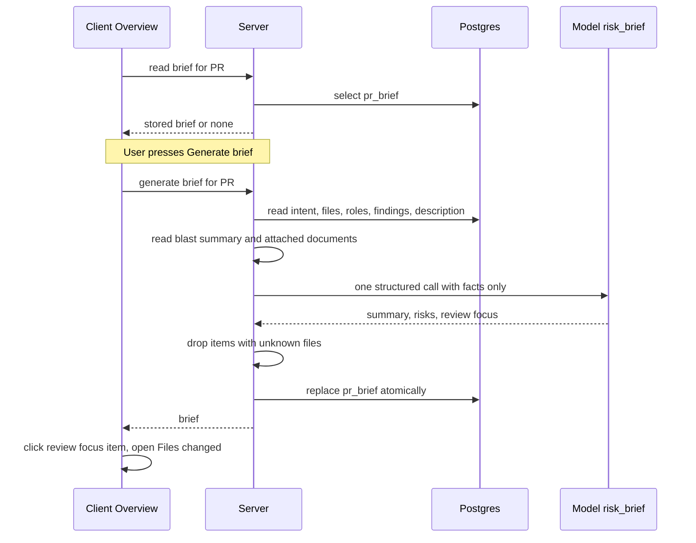

# Spec: PR Brief (model-written Risk areas and Review focus on the Overview tab)
Spec ID: SPEC-2026-10-11-pr-brief
Status: approved

## Problem and user
A reviewer who opens a pull request must work out by hand where the risk is and which files to read
first. The Overview tab already shows the PR's Intent and its Blast radius, and the Files changed tab
already groups files by role, but nothing combines these facts into a short judgment. The user is the
person reviewing a PR in DevDigest.

This spec adds the **PR Brief** card on the Overview tab. One model call turns facts the system has
already computed into two model-written parts: **Risk areas** (concrete risks, each tied to a file) and
**Review focus** (where to start reading and why). The brief is generated on demand, cached per PR,
and can be regenerated. The model never reads the diff code.

Baseline in the current code (analysis, not a change request):
- Table `pr_brief` (`pr_id` primary key, `json` jsonb) exists since the initial migration. Nothing reads or
  writes it, no route exposes it, and the shared `PrBrief` schema has no consumer.
- `PrBrief { intent, blast, risks, history }` has no summary and no review focus, and requires `intent`,
  `blast` and `history`.
- Intent: `GET /pulls/:id/intent` (service `getIntent(workspaceId, prId)`) returns the persisted record or
  `null` when none was derived. Blast radius: `GET /pulls/:id/blast` (pure read, no LLM). Smart Diff:
  `GET /pulls/:id/smart-diff` (pure read, roles `core | tests | wiring | docs | boilerplate`). File stats:
  `GET /pulls/:id` returns `files[]` with `additions`/`deletions`; `pr_files` is filled only after that
  endpoint has run once for the PR.
- Settings already has the `risk_brief` feature model ("Risk Brief", default provider `openai`, model
  `gpt-4.1`); no code resolves it yet. `resolveFeatureModel(container, workspaceId, 'risk_brief')` exists.
- Attached documents (Project Context) are stored per agent (and per skill) and per repository, and are
  resolved for an agent run by `resolveForRun(workspaceId, agentId, repo)`.
- The Overview tab renders the Intent card and the Blast radius card side by side, then the PR description.
  Tabs are selected with the `tab` query parameter (`overview`, `findings` = Agent runs, `diff` = Files
  changed). The Files changed tab has no way to open a given file.
- `VerdictBanner` (verdict, summary, findings count, PR score) exists and is used on the Agent runs tab.

## Goals / Non-goals
- Goals:
  - G1. Show a PR Brief card on the Overview tab with a Generate brief action while no brief exists, next to the Intent and Blast radius blocks (AC-1..AC-6, AC-29).
  - G2. Generate the brief with exactly one model call from precomputed facts only, never from diff code (AC-15..AC-21).
  - G3. Show the summary, Risk areas (title + file, severity) and Review focus (`file:line — reason`) (AC-8..AC-14).
  - G4. Let the user jump from a Review focus item to that file on the Files changed tab (AC-13).
  - G5. Cache the brief per PR so a reload shows the same brief without a new model call; allow regeneration (AC-7, AC-22..AC-25).
  - G6. Degrade honestly when an input is missing and say which one (AC-26..AC-28a).
  - G7. Keep workspace isolation and untrusted-input handling (AC-14, AC-30).
- Non-goals:
  - Reading or sending diff code, hunks or patches to the model.
  - "Prior PRs touching these files" (the design shows it; out of scope here).
  - PR history (`PrBrief.history`): not generated or shown.
  - Automatic generation (on PR open, on push, or after a review). Generation is user-triggered only.
  - Deriving the Intent or indexing the repository as a side effect of generating a brief.
  - Changing the Intent card, the Blast radius card or the Smart Diff behavior.
  - Posting the brief to GitHub or exposing it through the MCP server.
  - Showing cost, token counts or the model name of the brief (the design shows cost and tokens; see Open questions).
  - Storing the head commit SHA in the brief and any stale indicator based on it (deferred by the user).
  - Agent-specific briefs: the brief belongs to the PR, not to a reviewer agent.

## User stories
- As a reviewer, I open a PR and press Generate brief, so that I see the main risks and where to start
  reading without reading the whole diff first.
- As a reviewer, I click a Review focus item, so that I land on that file in Files changed.
- As a reviewer, I reload the page and see the same brief at once, so that I do not pay for another model call.

## Priorities
The design shows more than is required. P1 = required in this spec, P3 = optional, built only if time allows;
P3 criteria are marked "(P3)" and are not part of "done".
- P1: summary text, Risk areas, Review focus, Generate/regenerate/cache, Intent and Blast radius placement.
- P3: the verdict banner with verdict and PR score (AC-31); expandable risk explanation (AC-32).
- Out: Prior PRs touching these files.

## Acceptance criteria (EARS)

**Card and states**
- AC-1 (state-driven): WHILE the Overview tab of a PR is open, the system shall show a "PR Brief" card
  above the Intent and Blast radius blocks.
- AC-2 (state-driven): WHILE no brief is stored for the PR and no generation is running, the card shall
  show a Generate brief button and the "Brief not available yet." message with a hint that matches the Generate action.
- AC-3 (event-driven): WHEN the user presses Generate brief, the system shall start one generation for
  that PR and show an in-progress state in the card with the button disabled.
- AC-4 (event-driven): WHEN a generation finishes successfully, the card shall replace the in-progress
  state with the brief without a page reload.
- AC-5 (unwanted behavior): IF a generation fails, THEN the card shall show an error with a retry action,
  and the system shall keep any previously stored brief unchanged and visible.
- AC-6 (state-driven): WHILE the stored brief is being loaded on page open, the card shall show a loading
  state; IF that load fails, THEN it shall show an error with a retry action (a failed load is not shown as
  "no brief yet").
- AC-7 (event-driven): WHEN the user reloads the page and a brief is stored for the PR, the card shall show
  that same brief, and the system shall make no model call.

**Brief content (what the user sees)**
- AC-8 (ubiquitous): The card shall show the brief's summary (what the PR does and why) as plain text.
- AC-9 (ubiquitous): The card shall show a "Risk areas" list in which every risk shows its title and the
  file(s) from its `file_refs`.
- AC-10 (ubiquitous): The system shall indicate each risk's severity (`high | medium | low`) by icon color
  and by a text alternative that does not depend on color.
- AC-11 (state-driven): WHILE the brief has no risks, the Risk areas part shall show the "No notable risks
  flagged." message.
- AC-12 (ubiquitous): The card shall show a "Review focus" list in the order stored, each item as
  `file:line` followed by its reason; an item without a line shall show `file` only.
- AC-13 (event-driven): WHEN the user clicks a Review focus item, the system shall open the Files changed
  tab of the same PR scrolled to that file (the line is not highlighted).
- AC-14 (ubiquitous): The system shall render all model-written text (summary, titles, reasons) as plain
  text and shall not interpret it as HTML or Markdown or load remote content from it.

**Generation (server)**
- AC-15 (event-driven): WHEN a brief is generated, the system shall call `llm.completeStructured` exactly
  once, with the provider and model resolved for the `risk_brief` feature of the caller's workspace.
- AC-16 (ubiquitous): The model input shall consist only of precomputed facts: the intent (summary,
  in/out of scope), the blast-radius `summary` and the list of caller files, per-file diff statistics (path,
  additions, deletions) with each file's Smart Diff role, the PR title and description, the findings of the
  newest review of each agent (file, line, severity and title only, the set Smart Diff uses), and the text
  of the documents attached to the workspace's agents for this PR's repository (AC-16a).
- AC-16a (ubiquitous): The system shall build the document set as the union of the effective attached
  documents (the agent's own, then those of its enabled skills) of every agent of the workspace for the
  PR's repository, in agent order, keeping only the first occurrence of each path, so the user chooses the
  documents by attaching them in Project Context.
- AC-16b (unwanted behavior): IF an attached document cannot be used (deleted, renamed, unreadable, empty or
  not valid UTF-8), THEN the system shall skip it, record a warning with its path in the log, and continue.
- AC-17 (ubiquitous): The system shall not send diff code, hunks or patches to the model, and shall not
  send finding bodies or code suggestions, only the fields listed in AC-16.
- AC-18 (ubiquitous): The system shall not make any other model call, derive an Intent, or start a repository
  resync or index as part of generating a brief; it shall read existing data only.
- AC-19 (ubiquitous): The system shall validate the model's answer against a schema containing exactly the
  summary, the risks and the review focus; the Intent, Blast radius and diff statistics shall not be
  model-written.
- AC-20 (unwanted behavior): IF a Review focus item names a file that is not among the PR's changed files,
  THEN the system shall drop that item before storing the brief.
- AC-20a (unwanted behavior): IF a Review focus item has a line that is not the line of any provided
  finding in that file, or the model gave no line, THEN the system shall store the item without a line.
- AC-21 (unwanted behavior): IF a risk has no `file_refs` that is either a changed file of the PR or one of
  the blast-radius caller files given to the model, THEN the system shall drop that risk before storing the
  brief, and shall drop any other `file_refs` of a kept risk that are neither.

**Cache and regeneration**
- AC-22 (ubiquitous): The system shall store the brief for a PR in `pr_brief.json` and shall keep at most
  one brief per PR.
- AC-23 (event-driven): WHEN the user presses the refresh button on an existing brief, the system shall
  generate a new brief and, only after it succeeded, replace the stored one in a single atomic write.
- AC-24 (state-driven): WHILE a regeneration is running, the card shall keep showing the previous brief and
  mark it as updating.
- AC-25 (state-driven): WHILE a generation started from the card is running, the Generate and refresh
  buttons shall be disabled; the system shall not store the running state.

**Missing inputs**
- AC-26 (unwanted behavior): IF the Intent, the Blast radius, the findings (no review yet), the attached
  documents, or the per-file statistics are not available for the PR, THEN the system shall still generate the brief from the inputs
  that are available and shall tell the model which inputs are missing.
- AC-27 (state-driven): WHILE the stored brief was generated without an input, the card shall name which
  data was missing (for example "Intent not derived yet").
- AC-28 (ubiquitous): The system shall take the PR's changed files and their additions and deletions from
  the same source the Intent derivation uses for its diff: the git diff between the PR's base and head in
  the repository clone, and, only when that yields no files, the stored `pr_files`; it shall not require
  that the PR was opened in the detail view first.
- AC-28a (unwanted behavior): IF neither the git diff nor the stored `pr_files` yields any changed file,
  THEN the system shall not call the model, shall not fetch the file list from GitHub, and shall report
  that file data is unavailable.

**Layout with Intent and Blast radius**
- AC-29 (ubiquitous): The Overview tab shall keep showing the existing Intent and Blast radius blocks next
  to the brief, with the labels `block.intent` and `block.blast` from `client/messages/en/brief.json`; these blocks shall
  keep reading live data from their own endpoints and not from the brief's stored copy.

**Access and trust**
- AC-30 (unwanted behavior): IF a request to read or generate a brief references a PR outside the caller's
  workspace, THEN the system shall respond as for any other missing PR and return no brief data.

**P3**
- AC-31 (P3, state-driven): WHILE at least one review of the PR exists, the card shall show the existing
  `VerdictBanner` with the newest review's verdict, findings and blocker counts and PR score, and the brief's
  summary as its text; WHILE no review exists, the card shall show the summary without the banner.
- AC-32 (P3, event-driven): WHEN the user expands a risk, the card shall show that risk's `explanation`.

**Limits** (the numbers are named constants in one place, tunable without a spec change)
- AC-33 (ubiquitous): The system shall bound the model input to: the first 8,000 characters of the PR
  description; the 50 changed files with the most changed lines, plus the total file count and per-role
  totals; at most 30 blast-radius caller files; at most 30 findings, highest severity first; and attached
  documents whole, in order, up to a total of 30,000 tokens.
- AC-34 (ubiquitous): The system shall bound the stored output to: a summary of at most 600 characters, at
  most 5 risks (each with a title of at most 100 characters and at most 3 `file_refs`), and at most 5
  Review focus items (each reason at most 240 characters); it shall keep the model's order and cut lists
  and over-long text itself instead of failing the generation.
- AC-35 (unwanted behavior): IF the input bounds of AC-33 omit any data (files, callers, findings or whole
  documents), THEN the system shall tell the model what was omitted and the card shall show that the brief
  was built from partial data.

## Edge cases
- No Intent for the PR (never derived): brief is generated without it and says so (AC-26, AC-27). Risk areas
  are always shown in the left column below the Intent block (which shows its own empty state when there is
  no Intent), next to Blast radius.
- Blast radius degraded (`degraded: true`, for example `no_data`) or with no callers: its summary and callers
  are passed with the degraded flag; an empty result is treated as missing.
- No document is attached for the repository: the documents are omitted and listed as missing; this is normal, not an error.
- No review has run yet: there are no findings, so Review focus items have no lines (AC-20a).
- Very large attached documents or a very large PR (hundreds of files): inputs are bounded and the omission
  is reported (AC-33, AC-35); a document is skipped whole, never cut in the middle.
- Model returns zero risks or zero review-focus items: stored as is; empty Risk areas shows AC-11, and an
  empty Review focus shows "No focus yet" (a new string in `brief.json`).
- Model returns too many items or over-long text: cut to the bounds of AC-34.
- Two tabs, or a page reload while a generation runs, can start a second generation because the running state is not stored (AC-25); both complete and the last atomic write wins.
- PR gets a new push after the brief was generated: the stored brief is still shown unchanged (AC-7); the
  user regenerates it with refresh. There is no stale indicator in this spec.
- The PR is deleted or the repository is removed: the stored brief is removed with the PR (existing cascade
  from `pull_requests`).
- Review-focus file is in a collapsed group or is a renamed/deleted file in Files changed: the jump must
  still reveal it. If the file is no longer in the current diff (the PR changed after the brief was
  generated), the click only opens the Files changed tab; there is no scroll and no error.
- Navigation back from Files changed returns to the Overview tab with the same brief shown (it is cached).
- File paths with non-ASCII characters or very long paths render and round-trip unchanged.

## Non-functional requirements
- Cost control: one generation causes exactly one `completeStructured` invocation — verified by a server
  test that counts the calls of the mock LLM provider for one generation, for a regeneration, and for a
  page reload (zero). The count is of invocations from our code; the adapter's internal re-ask when the
  first JSON fails schema validation is not counted.
- Privacy: no diff code leaves the server — verified by a test asserting that the messages passed to the
  mock provider contain no patch or hunk text for a PR whose git diff and stored files have patches.
- Security (untrusted input): PR title and description are attacker-controlled text and attached documents
  are repository-authored text; both are passed as delimiter-wrapped untrusted data with the injection guard
  already used for review prompts — verified by a unit test of the prompt with a description containing the
  closing delimiter and an instruction. The PR description shall get the same secret redaction as the
  Intent derivation applies to it — verified by a unit test with a description containing a fake secret.
- Security (output): model text is rendered as plain text (AC-14) — verified by a client test rendering a
  brief whose summary contains a script tag and an image URL.
- Access: AC-30 — verified by a server integration test with a PR of another workspace.
- Performance: reading a stored brief is a single database read — verified by a server test asserting no LLM
  and no GitHub call on the read path.
- Accessibility: severity is available as text (AC-10), Generate, refresh and Review focus items are
  keyboard-operable buttons or links — verified by a manual keyboard-only pass.
- Observability: each generation logs, without the document or description text, the PR id, the resolved
  provider and model, the list of missing inputs and the outcome — verified by reading the log of a test
  generation.
- Internationalization: all new visible strings come from `client/messages/en/brief.json` — verified by a
  client test that renders the card with the message catalog.

## Inputs and provenance
Producers verified in the repo (data-source check):

| Value on the screen or in the prompt | Producer | State |
|---|---|---|
| Intent (summary, in/out of scope) | `pr_intent` row via `GET /pulls/:id/intent`; written by the Intent Layer on review/rederive | exists; may be `null` for a PR |
| Blast summary and caller files | `GET /pulls/:id/blast` (reads `pr_files` + repo-intel, no LLM) | exists; degraded cases handled |
| Per-file additions/deletions | git diff base...head in the clone (`loadDiff`, as the Intent derivation uses), fallback `pr_files` (filled by `GET /pulls/:id`) | exists; works for a PR never opened in the detail view when the clone is available |
| File roles | `GET /pulls/:id/smart-diff` (pure DB read) | exists |
| PR title, description, head SHA | `pull_requests` | exists |
| Findings (file, line, severity, title) | newest review of each agent: `latestReviewFindings` (used by Smart Diff) | exists when a review ran |
| Attached documents text | Project Context attachments of agents and skills per repository (`resolveForRun` is keyed by one agent; the brief takes the union over agents, AC-16a) | exists |
| Brief (summary, risks, review focus) | none: this feature | `pr_brief` has no writer today |
| Model for the brief | Settings → `risk_brief`; `resolveFeatureModel` | exists; no caller yet |
| PR score and verdict (P3) | newest review of the PR | exists when a review ran |
| Cost and token counts shown in the design banner | no brief-level producer | not in scope |

- System-controlled: stored facts above, the resolved model, the head SHA, the validation of files.
- User-controlled: pressing Generate/refresh, the PR description, and the text of attached documents
  (through the repository).
- The contract `server/src/vendor/shared/contracts/brief.ts` is the single source. The task text says the
  client has an identical copy, but `client/src/vendor/shared` is a symlink to the server directory (see
  `CLAUDE.md` and `ENGINEERING-INSIGHTS.md`), so there is one file to change and no second copy to keep in
  sync. The change: add `summary` and `review_focus: [{ file, line, reason }]` to `PrBrief` (with `line`
  nullish, see AC-20a), and make `intent`, `blast` and `history` optional so a brief can exist without
  them. No SHA field is added.

## Untrusted inputs
- PR title and description, and attached document text, are untrusted: delimiter-wrapped, covered by the
  injection guard, never treated as instructions (NFR Security).
- Model output is untrusted: schema-validated (AC-19), file references checked against the PR's files
  (AC-20, AC-21), rendered as plain text (AC-14).
- The PR id in the request is untrusted: validated as an id and scoped to the caller's workspace (AC-30).
- Line numbers in Review focus come from the model: a line is kept only if it matches a provided finding
  line in that file (AC-20a).

## Open questions
- Resolved by the user: Review focus lines come from the findings of the latest review (AC-16, AC-20a);
  the running state is only the disabled button, never stored (AC-25); Intent and Blast radius keep reading live data; Review focus click scrolls to the file; the brief concerns the PR only, not an agent; its documents are all those the user attached to agents of the repository in Project Context (AC-16a, option c); `intent`, `blast` and `history` become optional; no SHA for
  now; one contract file only (the client path is a symlink); copy and names in the repo may differ from the
  task text, the code wins (for example `getIntentRow` for the intent, "Risk areas" as the card label).
- Resolved by the user: a risk may reference a blast-radius caller file that the PR did not change (AC-21); Review focus items still only name changed files (AC-20).
- Resolved by the user: file statistics come from the git diff with `pr_files` as fallback, as for the Intent (AC-28); the brief is generated only by the button, never automatically with an agent run; no GitHub fetch when files are missing; Risk areas always sit in the left column under the Intent block, with or without an Intent, next to Blast radius; Project Context works as it does today and the brief reads what the user attached to agents (documents nobody attached are simply unused); empty Review focus reads "No focus yet"; a file gone from the diff is ignored on click; the adapter's re-ask is not counted; the PR description is redacted like the Intent.
- Resolved by recommendation (please object if wrong): input and output limits as in AC-33..AC-35. The
  limits keep cost and latency predictable, keep the card readable (the design shows 3 risks and 4 focus
  items), and cut instead of failing, so the one-call rule holds.
- Proposal: rate-limit Generate and refresh like the Intent re-derive route (10 per minute) because each
  press costs one model call.
- Proposal: sort risks by severity (high first) when stored, so the list does not depend on model order.
- Proposal: show the brief's cost and token counts as in the design banner (needs the call's usage saved in
  the JSON).
- Proposal: highlight the target line, not only the file, after a Review focus click (the user chose scroll to file only).
- Architecture impact: (1) The shared contract `brief.ts` changes (new `summary`, `review_focus`,
  optional `intent`/`blast`/`history`); one file, since the client uses a symlink. (2) New server endpoints:
  read the stored brief and generate/regenerate it; the `pr_brief` table needs no migration. (3) A new
  consumer of the `risk_brief` feature model and a new dependency from the brief use case on Intent,
  Blast radius, Smart Diff, PR files and Project Context; `docs/architecture.md` should record that data
  flow. To be folded in by a human.
