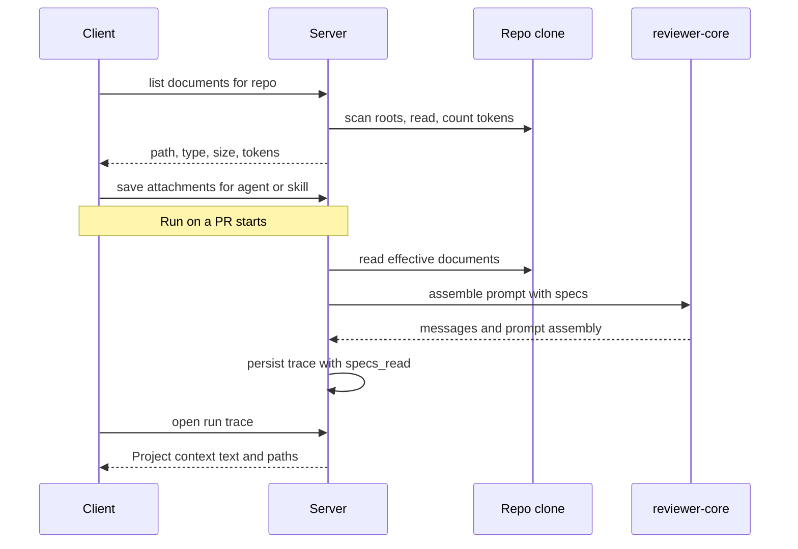

# Spec: Project Context (spec-driven grounding for agents and skills)
Spec ID: SPEC-2026-10-11-project-context
Status: approved

## Problem and user
Reviewer agents judge a PR from the diff alone, so they cannot tell that a change violates a
documented decision (for example "module `api/` must not import `db/` directly" or "all public
endpoints MUST be rate-limited"). The people who configure agents and skills (team leads, platform
engineers) have PRDs, specs, architecture docs and insights as Markdown in the repository, but no
way to choose which of them an agent or skill must always be grounded in, to see what that costs
in prompt tokens, or to verify afterwards exactly which text the model received.

This spec adds the **Project Context** feature: discover `.md` documents in the repo, let the user
view them and attach them **manually** to agents and skills, show token cost while choosing, inject
the chosen documents into every run as an untrusted block, and expose the injected text in the run
trace. Documents are **view-only** in the product (see Non-goals).

Baseline in the current code (design-source analysis, not a change request):
- `reviewer-core` `assemblePrompt` already renders a `## Project context` section from `parts.specs`
  (each item delimiter-wrapped as untrusted) and records it as `prompt_assembly.specs`; the injection
  guard is already appended to the system message.
- `run-executor` never passes `specs`, always writes `specs_read: []`, and the failure/cancel trace
  (`traceFromBuffer`) writes `specs: null`.
- The shared `SpecFile` contract and client hook `useContextFiles` call `GET /repos/:id/context`; no
  such server route exists. The client i18n copy still says specs live under `.devdigest/specs/`.
- No Project Context page, no Context tab on agents or skills, no attachment storage exist.
- A token counter (cl100k_base, with a chars/4 fallback) already exists in the server.

## Goals / Non-goals
- Goals:
  - G1. Discover Markdown documents in configurable roots of a repository (AC-1..AC-7).
  - G2. Browse and preview those documents on the Project Context page, view-only (AC-8..AC-13, AC-48).
  - G3. Manually attach documents to an agent, per repository, with order (AC-14..AC-20, AC-25, AC-46, AC-47).
  - G4. Manually attach documents to a skill, inherited by every agent that uses the skill (AC-21..AC-25).
  - G5. Show token cost of documents and attachment sets at selection time (AC-26..AC-30).
  - G6. Inject the effective documents into every run as an untrusted `## Project context` block,
    with no extra LLM call, storing only paths in metadata (AC-31..AC-38).
  - G7. Make the injected text inspectable in the run trace (AC-39..AC-44).
  - G8. Keep workspace isolation and untrusted-input handling intact (AC-4, AC-35, AC-45..AC-48).
- Non-goals:
  - Creating, editing, uploading or deleting documents in the product. The server clone is a git
    working copy that is refreshed from the remote, so local writes would be lost or diverge, and
    saving properly would need commit/push rights. Documents are changed in the repository itself.
    The Edit tab, "+", new-folder and upload controls of the design are therefore not built.
  - Coverage metric (the "Coverage" ring of the design is not built).
  - Automatic selection of relevant documents from PR content (separate feature; manual only here).
  - Embedding/semantic retrieval or chunk-level selection (whole documents only).
  - Non-Markdown documents (PDF, DOCX, images).
  - Versioning of attachments: attaching or detaching documents does not create a new agent or skill version.
  - Changing how repo skeleton, callers, memory or PR description are assembled.

## User stories
- As a team lead, I attach `specs/security-baseline.md` to the Security Reviewer, so that its
  findings cite the baseline instead of generic advice.
- As a skill author, I attach `specs/public-api.md` to `pr-quality-rubric`, so that every agent
  using that skill inherits the PRD.
- As a reviewer of a run, I open the run trace and read the exact project-context text the model
  received, so that I can tell whether a finding was grounded in the document.

## Acceptance criteria (EARS)

**Discovery (reader)**
- AC-1 (ubiquitous): The system shall list as project-context documents every `.md` file found
  recursively under the configured search roots of a repository's source clone.
- AC-2 (ubiquitous): The system shall use the default pattern `**/{specs,docs,insights}/**/*.md`
  when no search roots are configured.
- AC-3 (optional feature): WHERE search roots or a glob are configured in the server configuration, the
  system shall discover documents using the configured value instead of the default.
- AC-4 (unwanted behavior): IF a discovered path resolves (including through a symlink) outside the
  repository clone root, THEN the system shall exclude it from the list and from any run.
- AC-5 (ubiquitous): The system shall return for each document its repo-relative path, document
  type (the matching root folder: `specs`, `docs` or `insights`), size in bytes, last-modified time
  and token count.
- AC-6 (event-driven): WHEN the user triggers refresh/resync on the Project Context page, the system
  shall re-scan the roots and update the list and token counts.
- AC-7 (unwanted behavior): IF a configured root does not exist in the repository, THEN the system
  shall list the documents of the remaining roots and shall not fail the request.

**Project Context page (view-only)**
- AC-8 (state-driven): WHILE the Project Context page is open for a repository, the system shall
  show the discovered documents as a selectable list.
- AC-9 (event-driven): WHEN the user selects a document, the system shall show its full text
  rendered as Markdown in a read-only Preview.
- AC-10 (state-driven): WHILE no document is discovered, the system shall show an empty state that
  names the search roots that were scanned.
- AC-11 (unwanted behavior): IF loading the list or a document fails, THEN the system shall show an
  error state with a retry action and shall keep previously loaded content visible where available.
- AC-12 (ubiquitous): The system shall show, in the list footer, the number of indexed files, the
  approximate total number of tokens of all indexed files ("tokens total") and the time of the last
  index.
- AC-13 (ubiquitous): The system shall show, for the open document, "Used by N agents", where N is
  the number of distinct agents that receive the document either by direct attachment or through an
  attached-and-enabled skill.

**Attach to agents**
- AC-14 (state-driven): WHILE the agent editor's Context tab is open, the system shall list all
  discovered documents of the selected repository with a checkbox, path, type badge, Preview action
  and a "N of M attached" counter.
- AC-15 (event-driven): WHEN the user toggles a document's checkbox, the system shall persist or
  remove the attachment for that agent, repository and path and update the counter.
- AC-16 (event-driven): WHEN the user reorders documents with the drag handle, the system shall
  persist the order, and the assembled block shall follow it.
- AC-17 (ubiquitous): The system shall store attachments as repository, path and order only, never
  the document text.
- AC-18 (event-driven): WHEN the user types in the filter, the system shall show only documents whose
  path contains the text, case-insensitively, without changing attachments.
- AC-19 (event-driven): WHEN the user presses Preview on a row, the system shall show the document's
  full text without attaching it.
- AC-20 (unwanted behavior): IF an attached path is no longer discovered, THEN the system shall still
  list it flagged as missing and shall allow the user to remove it.

**Attach to skills**
- AC-21 (state-driven): WHILE the skill editor's Context tab ("Project context to use") is open, the
  system shall offer the same list and attach/detach behavior as AC-14..AC-20, stored per skill,
  repository and path.
- AC-22 (event-driven): WHEN a skill with attached documents is linked and enabled for an agent, the
  system shall include those documents in that agent's effective set.
- AC-23 (ubiquitous): The system shall build the effective set as the agent's own documents in agent
  order, followed by documents of each enabled linked skill in skill order and then document order,
  keeping only the first occurrence of each path.
- AC-24 (ubiquitous): The skill's Context tab shall show a "Serializes as" preview that lists the paths
  of its attached documents; the full text is injected into the prompt as described in AC-31.
- AC-25 (ubiquitous): The system shall not create a new agent or skill version when attachments change.

**Tokens**
- AC-26 (ubiquitous): The system shall compute each document's token count from its text on the
  server and return it with the document list.
- AC-27 (state-driven): WHILE the agent Context tab is open, the system shall show the approximate
  total tokens of attached documents (prefix "≈") and update it immediately when attachments change.
- AC-28 (state-driven): WHILE the skill Context tab is open, the system shall show the total tokens of
  that skill's attached documents.
- AC-29 (unwanted behavior): IF the attached total exceeds a fixed warning threshold from the server
  configuration, THEN the system shall show a warning next to the total and shall not truncate or
  block the attachment. The default threshold is 100,000 tokens.
- AC-30 (ubiquitous): The system shall show each document's token count in the list rows.

**Runtime injection**
- AC-31 (event-driven): WHEN an agent run starts for a PR of repository R, the system shall read the
  effective documents (AC-23) for R from the repository's synced clone and add them to the prompt in a
  `## Project context` section, each wrapped as untrusted data, with the injection guard present in the
  system message.
- AC-32 (ubiquitous): The system shall add project context without any additional LLM call.
- AC-33 (unwanted behavior): IF the effective set is empty, THEN the system shall omit the
  `## Project context` section and record an empty `specs_read`.
- AC-34 (unwanted behavior): IF an attached document cannot be used at run start (deleted, renamed,
  unreadable, outside the root, empty or not valid UTF-8), THEN the system shall skip it, record a
  warning with its path in the run log and continue the run.
- AC-35 (unwanted behavior): IF a document's text contains the untrusted-block closing delimiter,
  THEN the system shall neutralize it so the text cannot end its own block.
- AC-36 (ubiquitous): The system shall read document text once at run start, so a later change never
  alters an already running or finished run's recorded text.
- AC-37 (state-driven): WHILE a multi-agent review runs, the system shall compute and inject the
  effective set separately for each agent.
- AC-38 (state-driven): WHILE an agent-skill link is disabled, the system shall exclude that skill's
  documents from the agent's effective set.

**Trace transparency**
- AC-39 (event-driven): WHEN a run finishes, the system shall record `specs_read` as the repo-relative
  paths of the documents actually injected, in prompt order.
- AC-40 (event-driven): WHEN the user opens a run's trace and documents were injected, the Prompt
  assembly list shall include a row labeled "Project context — attached specs (untrusted)" with
  expand and copy actions.
- AC-41 (event-driven): WHEN the user expands that row, the system shall show the complete text
  exactly as sent to the model, including delimiters and the `## Project context` heading.
- AC-42 (ubiquitous): The trace Configuration section shall list the paths read ("Specs read") and the
  token count of each document and of the block.
- AC-43 (unwanted behavior): IF a run fails or is cancelled after documents were loaded, THEN the
  system shall still persist `specs_read` and the project-context text in its trace.
- AC-44 (state-driven): WHILE a run injected no documents, the Prompt assembly list shall not show the
  project-context row.

**Access and validation**
- AC-45 (unwanted behavior): IF a request references a repository outside the caller's workspace,
  THEN the system shall respond 403 and return no document data.
- AC-46 (unwanted behavior): IF an attach request contains a path that is not a discovered document,
  a duplicate path or a duplicate order value, THEN the system shall reject the whole request.
- AC-47 (event-driven): WHEN the user saves a new attachment set, the system shall replace the previous
  set atomically, so a failure leaves the previous set intact.
- AC-48 (ubiquitous): The system shall render document Preview without executing raw HTML or loading
  remote content found in the document text.

## Edge cases
- Document deleted/renamed after attaching: attachment stays flagged (AC-20); runs skip it and record a warning (AC-34).
- Same document attached directly and via two skills: injected once (AC-23).
- Attachment made for repo A, run on a PR of repo B: attachments are per repository, so none apply (AC-31).
- Very large document or many documents: warning only, no truncation (AC-29); the trace shows the real tokens.
- Empty or non-UTF-8 document: skipped with a recorded warning (AC-34).
- Document with injection text ("ignore previous instructions") or a fake closing tag: stays inside its
  untrusted block (AC-35).
- Discovery matching third-party folders (e.g. `node_modules/*/docs/*.md`, `.pnpm-store`) because the glob
  matches `docs` at any depth. See Proposal below.
- Document changes in the repo while a run starts: the run reads one snapshot (AC-36).
- Concurrent attach changes from two tabs: last atomic save wins (AC-47).
- Clone is behind the remote: runs and the page see the clone as last synced; refresh (AC-6) re-reads it.
- Agents or detectors without an LLM call: no project context (AC-33).
- Long paths and non-ASCII file names must render and round-trip unchanged.

## Non-functional requirements
- Performance: listing documents with token counts for a repository with up to 200 documents returns within
  1 s p95 (target) — verified by a server integration test with a generated 200-file fixture.
- Performance: attaching documents must not add a model call — verified by asserting the LLM call count of
  a run is unchanged with and without attachments (AC-32).
- Security: workspace isolation and path containment (AC-4, AC-45) — verified by tests with a symlink escaping
  the clone and with a foreign-workspace repo id; delimiter escape (AC-35) — verified by a unit test of prompt
  assembly with a document containing the closing tag; safe Preview (AC-48) — verified by a client test that
  renders a document containing a script tag and a remote image.
- Security: document text is not written to logs at info level; only paths and token counts — verified by
  inspecting the run log of a test run.
- Observability: every run records `specs_read`, per-document tokens and skip warnings — verified by reading
  the persisted trace of a test run (AC-39, AC-42, AC-34).
- Accessibility: the Context tabs (checkboxes, reorder, filter, preview) are usable with keyboard only;
  reorder has a keyboard alternative to drag — verified by a manual keyboard-only pass.
- Token accuracy: shown counts are approximate (cl100k_base) and labeled "≈"; the trace uses the same
  counting method — verified by comparing the UI total with the server value for a fixture.

## Inputs and provenance
- System-controlled: repository clone and its Markdown files (content authored by repo contributors, so
  untrusted for the model), search roots/glob from server configuration, token counts, effective-set computation.
- User-controlled: which documents are attached, their order, the filter text, and Markdown text inside any
  document (through the repository).
- Run-time source of document text: the synced clone of the repository's default branch, the same copy the
  Project Context page shows. Documents on the PR's own branch are not read.
- The development branch for this feature is `feature/L05-spec-driven-development`; all work happens on it.

## Untrusted inputs
- Document text is untrusted: it must be delimiter-wrapped, covered by the injection guard, and never treated
  as instructions (AC-31, AC-35).
- Document paths from clients are untrusted: validate against the discovered set, reject traversal, absolute
  paths, duplicates (AC-4, AC-46).
- Document Preview must not run scripts or fetch remote content (AC-48).
- Repository ids and attachment endpoints are workspace-scoped (AC-45).

## Open questions
- Resolved by the user: the warning threshold for the attached total is 100,000 tokens (AC-29).
- Resolved by the user (kept for traceability): documents are view-only, so Edit/New/Upload are out; a missing
  attached document is skipped and recorded; Coverage is dropped and only the number of agents using a document
  is shown; no new version on attachment changes; simplest implementation is preferred.
- Resolved by "simplest implementation" (please object if wrong): runtime source is the synced default-branch
  clone; search roots come from server configuration; the skill "Serializes as" panel lists paths only; the
  trace hides the project-context row when nothing was injected; empty and non-UTF-8 documents are skipped with
  a warning; Preview strips raw HTML and remote content; roots are `specs/`, `docs/`, `insights/` and
  `.devdigest/specs/` from the old copy is not a root; differing mock file lists across the design screens are
  sample data only.
- Proposal: exclude `node_modules`, `.git`, `.pnpm-store`, `dist` and vendored directories from discovery.
- Proposal: in the trace, link each finding's cited document back to its row in Prompt assembly.
- Architecture impact: (1) shared contract `RunTrace.specs_read` is `string[]`; per-document token counts
  (AC-42) need a new field or a changed shape — a contract change across the `server` and `client` vendor
  copies (the client copy is a symlink to the server one). (2) New persisted attachment relations
  (agent, repo, path, order) and (skill, repo, path, order) and new server endpoints for document list/read and
  attachments. (3) `docs/architecture.md` should record that the run-executor now reads repository documents at
  run time. To be folded in by a human.
- Acceptance scenario (verification, not behavior): attach a document with the invariant "module `api/` must not
  import `db/` directly" to a reviewer, open a PR that violates it, run the review, then confirm the prompt
  assembly contains the document and that the reviewer's finding cites that document. Model output is
  non-deterministic, so the deterministic check is the trace (AC-40, AC-41); the finding citation is a manual or
  eval-level check.
