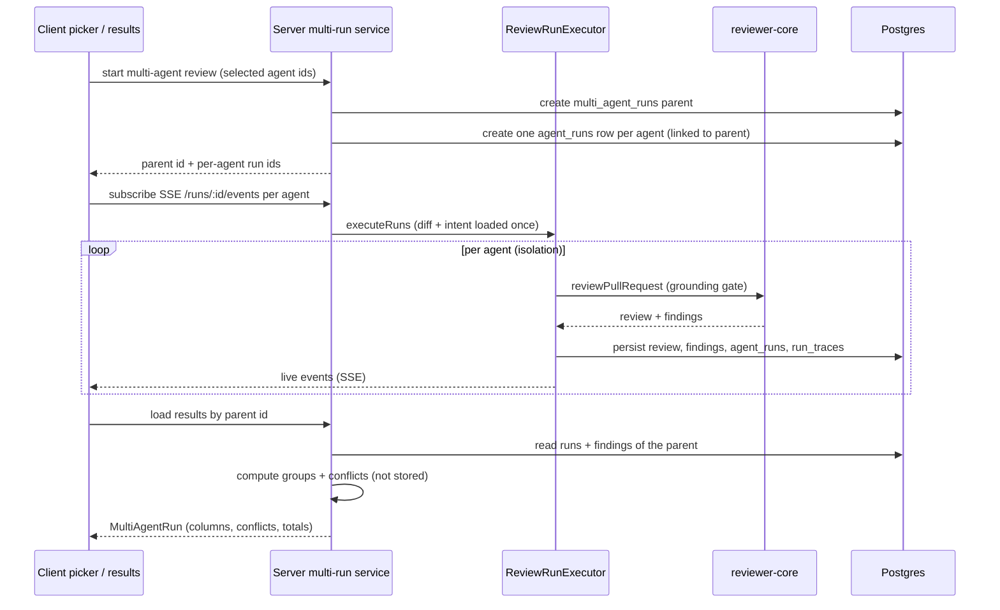

# Spec: Multi-Agent Review (worktree A)
Spec ID: SPEC-2026-10-17-multi-agent-review
Status: draft
Decisions resolved: 2026-10-18 (see Resolved decisions D1-D12); no unresolved questions remain.

## Problem and user
A reviewer in DevDigest has several specialized agents (Security, Performance, a stack/conventions
mentor, a customer-facing reviewer, an architecture reviewer, …). Today the PR page can run exactly one
agent, or "all enabled agents", through the `RunReviewDropdown`; there is no way to pick an explicit
subset, see what a multi-agent run would cost before starting it, or read the results side by side. When
several agents do flag the same issue, the reviewer sees the finding repeated once per agent with no way
to tell which agents agreed. The user is the person reviewing a PR in DevDigest who wants to run a chosen
set of reviewers on one PR, read their results collapsed where they overlap, see where they disagree, and
pay an honest, measured cost.

This spec covers **worktree A**: the agent picker on the PR page, a "Configure run" screen, a multi-run
service that groups the per-agent runs under one parent (`multi_agent_runs`), a cross-agent finding
grouping, a "Where agents disagree" view, and a two-mode results page — all built on infrastructure that
already exists (see Inputs and provenance). It does **not** add the parallel execution engine, the CI
runner, memory/curator, or per-agent stats; those are existing or out of scope (see Non-goals).

Baseline in the current code (analysis, not a change request — real paths cited):
- `POST /pulls/:id/review` (`server/src/modules/reviews/adapters/inbound/http/routes.ts:33`) accepts a body
  validated by `RunRequest` (`server/src/vendor/shared/contracts/platform.ts:374`), which has only
  `agentId?` and `all?`. There is **no field for a selected subset** of agents.
- `ReviewService.runReview` (`server/src/modules/reviews/service.ts:116`) creates one `agent_runs` row per
  target up front, then fires `ReviewRunExecutor.executeRuns` fire-and-forget. `executeRuns`
  (`server/src/modules/reviews/run-executor.ts:78`) loads the diff and intent **once**, then runs each
  agent with per-agent failure isolation (one agent's failure does not abort the others). It does **not**
  create or reference a `multi_agent_runs` parent; runs are grouped only implicitly by `pr_id`.
- Execution is **sequential** today: `executeRuns` iterates `for (const { agent, runId } of jobs)` and
  `await`s each `runOneAgent`. The design and the lab text describe a parallel "fan-out"; whether worktree
  A may make execution concurrent, or must present the sequential engine honestly, is an open question (see
  Resolved decisions D2).
- The SSE bus (`server/src/platform/sse.ts`) buffers events per run and, on `subscribe`, replays the
  **entire** buffer. The client (`useRunEvents`, `client/src/features/reviews/api/hooks.ts:23`) uses
  `EventSource`, whose reconnect sends `Last-Event-ID`, but the server ignores it and the route
  (`routes.ts:54`) yields `id: String(e.seq)` while re-sending the whole buffer. A reconnect therefore
  **re-delivers already-seen events**; "send last event id, get only missed events" is not implemented.
- `run_traces` (`server/src/db/schema/runs.ts:36`) stores one `RunTrace` jsonb document per run
  (`server/src/vendor/shared/contracts/trace.ts:96`). `RunTrace` records config (agent, version, provider,
  model, source `local|ci`, correlation_id), stats (duration, tokens, cost, findings, grounding),
  prompt_assembly, tool_calls, intent_call, and the full log. It has **no explicit `schema_version`
  field**. The versioning the lab text asks for is not present.
- `multi_agent_runs` (`server/src/db/schema/runs.ts:43`) exists with only `id`, `workspace_id`, `pr_id`,
  `ran_at`. Nothing writes or reads it. There is **no link column on `agent_runs`** pointing at a parent.
- The multi-agent shared contracts already exist as stubs: `MultiAgentRun`, `AgentColumn`,
  `AgentColumnFinding`, `Conflict`, `ConflictTake` in `server/src/vendor/shared/contracts/observability.ts`,
  documented as the response of `POST /pulls/:id/multi-agent-run` and `GET /pulls/:id/multi-agent`. **No
  route, service, or repository implements them.**
- There is **no cross-agent finding-grouping heuristic** in the repo. `build-smart-diff.ts`
  (`server/src/modules/reviews/smart-diff/build-smart-diff.ts`) groups PR *files* by role and attaches
  finding *lines*; `latestReviewFindings` dedupes by newest-review-per-agent. Neither groups *findings
  across agents* by file + overlapping line range + substance similarity. The lab text's "ready heuristic"
  does not exist as described (see Resolved decisions).
- UI scaffolds exist but are unwired for this feature: `RunReviewDropdown`
  (`client/src/app/repos/[repoId]/pulls/[number]/_components/RunReviewDropdown/RunReviewDropdown.tsx`) runs
  one agent or all; `LiveLogStream`, `ExportWizardSteps`, `AutoTriggerStatus`
  (`client/src/vendor/ui/`); `RunTraceDrawer`
  (`client/src/app/repos/[repoId]/pulls/[number]/_components/RunTraceDrawer/RunTraceDrawer.tsx`) streams
  live log via `useRunEvents` and loads the persisted trace.
- The sidebar already has a "Multi-Agent Review" nav key that lights up on any path containing
  `/multi-agent` (`client/src/components/app-shell/helpers.ts:28`), but **there is no `/multi-agent`
  route/page** under `client/src/app/`.
- Per-agent cost/time estimate source: there is **no stats or estimate endpoint**. The raw material exists
  in `agent_runs` (`duration_ms`, `tokens_in/out`, `cost_usd`, `status`, `agent_id`, `pr_id`;
  `server/src/db/schema/runs.ts:8`), queryable via the reviews repository, but no producer aggregates past
  runs into an estimate (see Resolved decisions).

## Goals / Non-goals
- Goals:
  - G1. Let the user pick an explicit subset of agents to run on one PR, from the PR page and from a
    "Configure run" screen, and start the run with one action labeled with the count (AC-1..AC-10).
  - G2. Show a pre-run time and cost estimate derived from past runs of each selected agent, with an honest
    "no history" state (AC-11..AC-16).
  - G3. Group the per-agent runs of one multi-agent review under a single parent record
    (`multi_agent_runs`) so the results page can load them as one (AC-17..AC-21).
  - G4. Collapse findings that several agents flagged at the same code location into one group, keeping
    every original finding, its text, and its agent attribution, and let the user expand the group
    (AC-22..AC-28).
  - G5. Show a "Where agents disagree" view: for one code location, each reviewing agent's conclusion —
    including "did not flag" with its reason — with a "Show only conflicts" toggle (AC-29..AC-34).
  - G6. Show results in two modes — Columns (status badge per agent) and Tabs + detail — with a "View trace" link per agent that opens the existing `RunTraceDrawer` (AC-35..AC-47).
  - G7. Report honest cost after completion: actual tokens, duration and cost per agent, and a recorded
    "1 vs N agents" comparison that is not forced to a 3× expectation (AC-48..AC-52).
  - G8. Keep workspace isolation, untrusted-input handling, and telemetry redaction/versioning for the
    multi-run surface (AC-53..AC-58).
- Non-goals (out of scope for worktree A — must not be built or changed here):
  - The parallel execution engine itself: `run-executor.ts`'s diff/intent-once + per-agent isolation is
    reused as-is through the service, not rewritten (reuse only; see Resolved decisions D2).
  - The `ci/` module and the `agent-runner/` package: not changed. No CI run, GitHub Action, or
    `agent_runs.source='ci'` path is added here.
  - Persistent Memory and the Curator pattern: out of scope. The "Learn" action on a finding relates to
    Memory; worktree A renders the button but its behavior beyond the existing single-finding action is a
    dependency, not built here (see Resolved decisions). `CuratorResult` contract is not touched.
  - Per-Agent Stats with denominators (`AgentStats`, `GET /agents/:id/stats`, the "Agent Performance" nav
    item): out of scope. The pre-run estimate (G2) is a separate, simpler aggregate, not the stats feature.
  - Changing the single-agent `RunReviewDropdown` "Run all enabled agents" / single-agent behavior, the
    `reviews`/`findings` schemas, the grounding gate, or `reviewer-core`.
  - Posting any multi-agent result to GitHub, or exposing it through the MCP server.
  - "Reply to author" as a GitHub write: the design shows the button, but a real reply posts a PR comment
    (an existing `POST /pulls/:id/comments` path) — whether worktree A wires it is an open question.

## User stories
- As a reviewer, I open PR #482 and pick Security + Performance from the Run Review panel, see "≈ cost ·
  time", and start the run, so that I run exactly the reviewers I care about.
- As a reviewer, I open "Configure run", choose a PR, tick the agents I want, read each agent's prior
  verdict on this PR and its per-agent estimate, and start the multi-agent review.
- As a reviewer, I watch four columns update live, and when two agents flag the same Retry-After issue I
  see one group with both authors, not two identical cards.
- As a reviewer, I open "Where agents disagree", toggle "Show only conflicts", and read why Security chose
  not to flag a magic number that the Junior Mentor did.
- As a reviewer, after the run I read each agent's actual tokens, duration and cost, and a "1 vs N agents"
  line that reflects real caching/shared-prep ratios rather than a claimed 3×.

## Acceptance criteria (EARS)

**Agent picker on the PR page**
- AC-1 (state-driven): WHILE the PR page header is shown, the system shall offer a "Run Review" control
  that opens a panel listing every agent of the workspace with a checkbox per agent.
- AC-2 (event-driven): WHEN the user opens the picker, the system shall preselect all enabled agents (disabled agents are listed but not selectable) and shall offer a "Clear" action that unchecks all.
- AC-3 (ubiquitous): The primary button in the picker shall show the count of currently selected agents,
  e.g. "Run multi-agent review (2)".
- AC-4 (unwanted behavior): IF no agent is selected, THEN the system shall disable the "Run multi-agent
  review" button and shall not start a run.
- AC-5 (event-driven): WHEN the user presses "Run multi-agent review (N)", the system shall start one
  multi-agent review of the N selected agents on the current PR and shall not run any unselected agent.
- AC-6 (ubiquitous): The picker shall offer a "Configure agents…" link to the Configure run screen for this PR.

**Configure run screen**
- AC-7 (state-driven): WHILE the Configure run screen is open with no PR chosen, the system shall show a
  pull-request selector and an agents placeholder reading that a PR must be chosen first.
- AC-8 (unwanted behavior): IF no pull request is selected, THEN the "Run multi-agent review" button shall
  be disabled (the design renders it enabled with a count; worktree A shall guard it).
- AC-9 (event-driven): WHEN the user selects a pull request, the system shall load that PR's agent list
  with, per agent, a one-line summary of the agent's most recent verdict on this PR (or an explicit "no
  prior run" text when none) and a per-agent estimate.
- AC-10 (ubiquitous): The Configure run screen shall offer a "Select all" action and per-agent checkboxes,
  and the run button shall show the selected count as in AC-3.

**Estimate (pre-run)**
- AC-11 (state-driven): WHILE a selected agent has at least one prior run with status `done` and `source='local'`, the system shall show a per-agent estimate equal to the mean duration and mean cost of its last 5 such runs across the workspace (not limited to this PR), computed on the server (D8).
- AC-12 (ubiquitous): The footer estimate shall present total time as max(longest per-agent time estimate, sum of per-agent time estimates / POOL_SIZE) and total cost as the sum of their cost estimates, and shall label the total as an estimate (D2).
- AC-13 (unwanted behavior): IF a selected agent has no prior completed run on which to base an estimate,
  THEN the system shall mark that agent's estimate as unavailable rather than showing a fabricated number,
  and shall still allow the run to start.
- AC-14 (state-driven): WHILE no selected agent has any prior run, the footer shall show that no estimate
  is available (not "≈ 0s · $0.00") and shall still allow the run.
- AC-15 (ubiquitous): The estimate shall be labeled as approximate and shall never be presented as the
  guaranteed cost or time.
- AC-16 (ubiquitous): The estimate's time basis shall match the real execution model: bounded concurrency with POOL_SIZE = 3 (D2), as in AC-12.

**Grouping runs under one parent**
- AC-17 (event-driven): WHEN a multi-agent review starts, the system shall create exactly one
  `multi_agent_runs` parent row for the PR and associate every per-agent `agent_runs` row of that review
  with it.
- AC-18 (ubiquitous): The system shall let a results request load all per-agent runs of one multi-agent
  review by its parent id, without relying on `ran_at` time windows.
- AC-19 (unwanted behavior): IF a per-agent run fails, THEN its `agent_runs` row shall still remain
  associated with the parent and appear in the results as a failed column (the parent is not abandoned).
- AC-20 (ubiquitous): The multi-agent results response shall carry the parent id, the PR id and number,
  the agent count, the total duration and total cost, the per-agent columns, and the computed conflicts
  (matching the existing `MultiAgentRun` contract in `observability.ts`).
- AC-21 (unwanted behavior): IF a results request references a `multi_agent_runs` parent, PR, or run outside the caller's workspace, THEN the system shall refuse it with 403 and return no data (D11).

**Finding grouping (collapse similar, keep originals)**
- AC-22 (ubiquitous): The system shall compute finding groups across the agents of one multi-agent review
  using a heuristic over (same file) AND (overlapping line ranges) AND (similar substance).
- AC-23 (ubiquitous): The grouping shall be presentation-only: it shall not delete, merge, or edit any
  stored `findings` row, and every original finding, its full text, and its producing agent shall remain
  available.
- AC-24 (event-driven): WHEN two or more findings from different agents fall in one group, the system shall
  show them collapsed as one card by default, labeled with the agents that contributed.
- AC-25 (event-driven): WHEN the user expands a group, the system shall show each contributing finding's
  original title, text, severity, confidence, and agent attribution.
- AC-26 (ubiquitous): The system shall never place two findings from the same agent into one group; they stay separate cards.
- AC-27 (ubiquitous): Two findings from different agents belong to one group IF they have the same file AND their line ranges overlap with a tolerance of LINE_TOLERANCE = 3 lines AND (the same `category` OR Jaccard similarity of lowercase title tokens >= TITLE_JACCARD_MIN = 0.5). Both constants are named and defined in one place; the function is pure and deterministic (D4).
- AC-28 (unwanted behavior): IF the heuristic is uncertain (below threshold), THEN the system shall keep
  the findings ungrouped rather than risk a wrong merge (false-negative is preferred to a lost finding).

**Where agents disagree**
- AC-29 (ubiquitous): The system shall show a "Where agents disagree" block listing code locations where
  at least one agent flagged an issue and at least one other reviewing agent did not, or where agents
  assigned divergent severities (matching the `Conflict`/`ConflictTake` contract).
- AC-30 (ubiquitous): For each location, the block shall show a cell per agent that reviewed the PR with
  that agent's conclusion: its severity if it flagged, or an explicit "did not flag" with the agent's note.
- AC-31 (unwanted behavior): IF an agent's run failed or is still running, THEN its take shall have verdict `no_result` (contract: extend `ConflictTake.verdict` with `'no_result'`); it is not counted as "did not flag", so it can neither create nor resolve a conflict.
- AC-32 (ubiquitous): The "did not flag" note is model-derived rationale; the system shall render it as
  plain text and shall not interpret it as HTML or Markdown.
- AC-33 (event-driven): WHEN the user toggles "Show only conflicts", the system shall show only locations
  that are actual conflicts (as AC-29) and hide locations where all reviewing agents agreed.
- AC-34 (ubiquitous): Conflicts are computed from persisted findings on read and are not stored. A conflict = at least one agent flagged the location and at least one completed agent did not, OR severities differ by 2 or more levels. The "did not flag" note is neutral derived text ("No finding reported by <agent> at this location") plus a link to that agent's review summary; there is no new model output (D3).

**Results page — Columns mode**
- AC-35 (state-driven): WHILE the results page is in Columns mode, the system shall show one column per
  selected agent with the agent name, score, duration, cost, and that agent's finding cards (severity,
  title, file:line).
- AC-36 (state-driven): WHILE any per-agent run is running, the results page shall poll `GET /pulls/:id/multi-agent/:parentId` every 2 seconds and each column shall show a status badge (queued, running, done, failed). Columns do not embed `LiveLogStream` and the page opens no per-agent SSE connection (D7).
- AC-37 (ubiquitous): Each column shall show a "View trace" link and that agent's finding count.
- AC-38 (event-driven): WHEN the user clicks "View trace" (Columns column or Tabs header), the system shall set `?trace=<run_id>` and mount the existing `RunTraceDrawer` (Trace tab: Configuration, Stats, Prompt assembly, Tool calls, Raw output; Live log tab; Copy raw output) with `runId`, `agentName`, `prNumber` and `running` (a running run opens on the Live log tab). Closing removes the param. No new drawer, endpoint or contract; `findings` is not passed in v1 (D7).
- AC-39 (unwanted behavior): IF one agent's run fails while others succeed, THEN its column shall show a
  failed state with the error, and the other columns shall still show their results (failure isolation is
  preserved end to end).

**Results page — Tabs + detail mode**
- AC-40 (ubiquitous): The results page shall offer a Columns | Tabs toggle.
- AC-41 (state-driven): WHILE in Tabs mode, the system shall show a tab per agent with that agent's score,
  and a header card for the selected agent with its score, summary, duration, cost, and a "View trace"
  link.
- AC-42 (ubiquitous): In Tabs mode, each finding card shall be expandable to show the finding's category,
  file:line, confidence, description, and suggested fix (when present).
- AC-43 (ubiquitous): Each finding card shall offer the actions Accept, Dismiss, Learn, and "Turn into
  eval case", reusing the existing finding-action paths where they exist.
- AC-44 (event-driven): WHEN the user presses Accept or Dismiss on a finding, the system shall call the
  existing `POST /findings/:id/(accept|dismiss)` action and reflect the new state.
- AC-45 (ubiquitous): "Reply to author", "Learn" and "Turn into eval case" shall render as disabled controls with a "not available yet" tooltip; Accept and Dismiss use the existing `POST /findings/:id/(accept|dismiss)` (D10).
- AC-46 (ubiquitous): Accept/Dismiss on a collapsed group shall act on every original finding of the group; the group shows a mixed state if its findings diverge (D12).
- AC-47 (state-driven): WHILE the results page is open, the "Where agents disagree" block (AC-29..AC-34)
  shall be shown at the bottom in both modes.

**Honest cost and the 1-vs-N measurement**
- AC-48 (ubiquitous): WHEN a multi-agent review completes, the results page shall show each agent's actual
  duration, actual tokens, and actual cost from that agent's completed `agent_runs` row (not the estimate).
- AC-49 (ubiquitous): The system shall present the total cost of a multi-agent review as the sum of the
  per-agent actual costs, and shall not claim a cost reduction from parallelism.
- AC-50 (ubiquitous): The system shall present total wall-clock duration honestly: the real time the
  multi-agent review took, reflecting whether its agents ran concurrently or sequentially (see AC-16 and
  Resolved decisions D2).
- AC-51 (ubiquitous): The results page shall show a computed "1 vs N" block: totals of actual tokens, cost and wall-clock of this review and, when a prior single-agent run of one of its agents exists on this PR, that run as the baseline (otherwise "no baseline"). Nothing new is stored and no N-times ratio is assumed (D9).
- AC-52 (unwanted behavior): IF an agent's cost is unknown (e.g. it failed before an LLM call, `cost_usd`
  null), THEN the system shall show its cost as unknown and shall exclude it from the total rather than
  treating it as $0 of real work.

**Access, trust, telemetry**
- AC-53 (unwanted behavior): IF a start, results, or estimate request references a PR, agent, or run outside the caller's workspace, THEN the system shall refuse it with 403; every new route shall resolve the workspace membership boundary the server enforces (D11).
- AC-54 (ubiquitous): Every new route shall validate its input with a Zod schema before the handler runs,
  and the start route's selected-agent set shall be validated (non-empty array of agent ids of the
  workspace).
- AC-55 (ubiquitous): `RunTrace` shall carry `schema_version: z.literal(1).default(1)`, optional on read so existing traces validate. The multi-agent response is computed on read and carries no version (D5).
- AC-56 (ubiquitous): The system shall not place secrets, full prompt tokens, raw tool output, or private
  repository content into multi-agent telemetry beyond what the existing per-run trace already records;
  raw prompt/tool text that is retained shall be subject to the existing redaction and access control.
- AC-57 (ubiquitous): The "Where agents disagree" notes, agent summaries, and finding text shall be
  rendered as plain text and shall not load remote content.
- AC-58 (ubiquitous): The multi-agent surface shall respect the existing retention/access rules for run
  traces; it shall not introduce a new store of raw prompt or diff content.

## Edge cases
- **Zero findings**: an agent that completes with no findings shows an empty column (not an error) and
  counts as "did not flag" for every location in the disagree view. A whole multi-agent review with zero
  findings across all agents shows an explicit empty state.
- **One agent selected**: allowed (N=1); grouping and conflicts are trivially empty; the "1 vs N" block shows the single-agent numbers without a baseline.
- **Agent failed**: failure isolation already works in `executeRuns`; the failed agent's column shows its
  error (AC-39), is excluded from the cost total (AC-52), and is not a silent "did not flag" (AC-31).
- **PR with no prior runs (no estimate)**: estimates are marked unavailable (AC-13, AC-14); the run still
  starts.
- **SSE reconnect / replay**: the server is unchanged; `useRunEvents` dedupes events by `seq` on the client. The results page itself does not open SSE (AC-36), only the drawer for one run does.
- **Duplicate findings (grouping case)**: the Retry-After-on-429 finding reported by both Security and
  Customer-Facing collapses into one group, keeping both originals and both authors (AC-22..AC-25).
- **Huge diffs / many agents**: the shared diff is loaded once in `executeRuns`. At most 6 agents per run; more is rejected with 422 at the route (AC-54).
- **Rate limit**: the new `POST /pulls/:id/multi-agent-run` has its own cap of 5/min; `POST /pulls/:id/review` is unchanged.
- **Workspace isolation (403)**: cross-workspace start/results/estimate requests are rejected (AC-53); the
  server refuses cross-workspace access as the auth boundary requires.
- **Redaction in traces**: raw prompt/tool content in telemetry stays under existing redaction (AC-56);
  the multi-agent surface adds no new raw-content store (AC-58).
- **Concurrent starts on one PR**: a start while any run of that PR is queued or running is rejected with 409 `multi_agent_run_active`.
- **Head moved after start**: findings are tied to the runs that produced them; results show the review
  that ran, as the single-agent flow already does.

## Non-functional requirements
- Failure isolation (end to end): one agent's failure must not hide another agent's results — verified by a
  results test with one `agent_runs` row `failed` and others `done`, asserting the failed column shows its
  error and the others render (AC-39).
- No new raw-content store / privacy: the multi-agent surface adds no table or field holding raw prompt,
  tool output, or diff text — verified by a schema review and a test asserting the results/estimate payloads
  carry only identifiers, counts, severities, titles, rationales, and the model-derived notes already
  persisted (AC-56, AC-58).
- Telemetry versioning: the trace / multi-agent record carries a schema version — verified by a contract
  test asserting the version field is present and matches the shared schema (AC-55).
- Access: cross-workspace start/results/estimate is rejected — verified by a server integration test
  against a PR/run of another workspace (AC-53, AC-21).
- Input validation: the start route rejects an empty or non-workspace agent set with 422 before the handler
  — verified by a route test (AC-54).
- Output safety: disagree notes, summaries, and finding text render as plain text — verified by a client
  test rendering a note containing a script tag (AC-32, AC-57).
- Grouping determinism: given the same findings, the grouping and conflicts are deterministic (stable order,
  no reliance on map iteration or wall-clock) — verified by a unit test of the grouping function with a
  fixed finding set (AC-22, AC-28).
- Cost honesty: the total cost equals the sum of per-agent actual costs and excludes unknown-cost agents —
  verified by a unit test over mixed `cost_usd` values including null (AC-49, AC-52).
- Accessibility: severity and "did not flag" are conveyed by text, not color alone, and the picker,
  checkboxes, mode toggle, "Show only conflicts" toggle, and "View trace" links are keyboard-operable —
  verified by a manual keyboard-only pass (AC-30, AC-35, AC-40).
- Internationalization: all new visible strings come from a client message catalog
  (`client/messages/en/*.json`) — verified by a client test rendering with the catalog.

## Inputs and provenance
Producers verified in the repo (data-source check):

| Value on the screen or in the response | Producer | State |
|---|---|---|
| Agent list + enabled flag | `GET /agents` / `useAgents` | exists |
| Per-agent "prior verdict on this PR" (one-line summary) | newest `reviews` row of that agent for the PR (`reviewsForPull`), `verdict`/`summary` | exists when the agent ran on the PR before; otherwise none |
| Per-agent score ring (38/64/72/58) | `reviews.score` / `agent_runs.score` of that agent's run | exists after a run completes |
| Per-agent duration / tokens / cost (actual, post-run) | `agent_runs.duration_ms`, `tokens_in/out`, `cost_usd` (`runs.ts:8`) | exists; `cost_usd` may be null on failure |
| Per-agent estimate (pre-run "8.2s · $0.06") | aggregate over past `agent_runs` of the agent | **no producer endpoint today** — raw rows exist, no aggregator (Resolved decisions D8) |
| Finding fields (severity, category, title, file, lines, confidence, rationale, suggestion) | `findings` rows via `GET /pulls/:id/reviews` | exists |
| Finding groups (collapsed cards) | this feature — cross-agent grouping heuristic | **no producer today**; must be built (AC-22, AC-27) |
| Conflicts (`Conflict`/`ConflictTake`) | this feature — computed from findings; `observability.ts` contract exists | contract stub exists; **no computer/route today** |
| Per-agent "did not flag" reason/note | unclear | **no producer identified** — findings record only what was flagged (AC-34) |
| Multi-agent parent (`multi_agent_runs`) | this feature — `runReview`/new service writes it | table stub exists (`runs.ts:43`), **no writer today**; needs a link from `agent_runs` to the parent |
| Live per-agent status | SSE `/runs/:id/events` + `agent_runs.status` | exists; reconnect replay-by-last-event-id **not implemented** (`sse.ts`) |
| Run trace per agent | `run_traces` + `GET /runs/:id/trace`, `RunTraceDrawer` | exists; **no `schema_version` field** (`trace.ts`) |
| Nav "Multi-Agent Review" | `activeKeyFor` matches `/multi-agent` (`helpers.ts:28`) | key exists; **`/multi-agent` route/page does not** |
| `MultiAgentRun`/`AgentColumn`/`Conflict` contracts | `server/src/vendor/shared/contracts/observability.ts` | exist as stubs; `client/src/vendor/shared` is a symlink to this source (one file to change) |

- System-controlled: run ids, parent id, actual durations/tokens/cost/status, trace documents, grouping
  output, conflicts, the resolved agent set.
- User-controlled: which PR, which agents are checked, the Columns/Tabs mode, "Show only conflicts",
  pressing start/Accept/Dismiss/Learn/Reply, and (indirectly) the PR diff and the agents' own prompts.

Cross-module communication (client ⇄ server ⇄ reviewer-core/run-executor):
- The client picker/Configure screen posts the selected agent set to the server start route and subscribes
  to `/runs/:id/events` (SSE) per agent, exactly as the single-agent flow does.
- The server's multi-run service resolves the agents, creates the `multi_agent_runs` parent, and reuses
  `ReviewRunExecutor.executeRuns` (which uses `@devdigest/reviewer-core` with the grounding gate) — the
  engine is reused, not rewritten.
- Shared contracts live only in `server/src/vendor/shared`; the client consumes them through the symlink
  (`client/src/vendor/shared`). Any contract change (e.g. a `schema_version`, a multi-select body field, a
  parent-id on results) is one file.
- Client cache invalidation: completing a review must invalidate the `pulls` query or the PR list keeps a
  stale score/findings (client `INSIGHTS.md`, `client/src/lib/hooks/reviews.ts:143`). A multi-agent
  completion must invalidate the relevant review/run/pulls queries the same way.

## Untrusted inputs
- The selected agent-id set in the start request is untrusted: validated as a non-empty array of ids that
  belong to the caller's workspace (AC-54); ids outside the workspace are rejected (AC-53).
- The PR id in every request is untrusted: validated and scoped to the caller's workspace (AC-21, AC-53).
- Model-derived text (agent summaries, finding titles/rationales, "did not flag" notes) is untrusted:
  rendered as plain text, never as HTML/Markdown, no remote content (AC-32, AC-57).
- The "Reply to author" body, if wired, is user-authored text destined for GitHub: it would need the
  existing comment path's validation (AC-45 — open).

## Resolved decisions (2026-10-18)
| ID | Decision |
|---|---|
| D1 | Start route `POST /pulls/:id/multi-agent-run`, results `GET /pulls/:id/multi-agent/:parentId`, own rate limit 5/min. `RunRequest` and `POST /pulls/:id/review` are not changed. |
| D2 | `executeRuns` gets an optional `concurrency` parameter (default 1 = today's behavior); the multi-agent start passes `POOL_SIZE = 3`. Diff and intent are still loaded once; per-agent failure isolation stays. Non-goal narrowed to "no rewrite of per-agent logic, only the loop". |
| D3 | "Did not flag" note = neutral derived text + link to that agent's review summary; no reviewer-core change. |
| D4 | Grouping heuristic per AC-27 (LINE_TOLERANCE 3, TITLE_JACCARD_MIN 0.5), pure function, never merges findings of one agent. |
| D5 | `schema_version` only on `RunTrace` (literal 1, default 1). |
| D6 | Picker defaults to all enabled agents; N between 1 and 6; second start on the same PR while one is active returns 409. |
| D7 | Logs live only in `RunTraceDrawer` via `?trace=<run_id>`; the results page polls every 2 s instead of N SSE connections; client dedupes SSE by `seq` in the drawer's `useRunEvents`. |
| D8 | Estimate = mean of last 5 `done` + `source='local'` runs of the agent across the workspace, server-side; fewer than 1 run means "no estimate". |
| D9 | "1 vs N" is a computed block on the results page; baseline = last single-agent run on the PR if any. |
| D10 | Reply to author, Learn, Turn into eval case are disabled placeholders. |
| D11 | Cross-workspace access returns 403 (server rule), not 404. |
| D12 | Accept/Dismiss on a group acts on every original; conflicts per AC-34. |

## Contract changes (one file: `server/src/vendor/shared/contracts/observability.ts`, plus `trace.ts`)
- `ConflictTake.verdict`: add `'no_result'`.
- `AgentColumn`: add `tokens_in`, `tokens_out`, status `queued`.
- `AgentColumnFinding`: add `end_line`, `confidence`, `rationale`, `suggestion`, `state` (open, accepted, dismissed), and `agent_id` attribution.
- `MultiAgentRun`: add `groups` (each group = ids of its findings, computed on read), `status` (running, partial, failed, done; derived from the runs), `estimate`-free (the estimate is a separate response).
- `RunTrace`: add optional `schema_version` (D5).
- New small response for the estimate: per agent `{ agent_id, mean_duration_ms, mean_cost_usd, sample_size }`.

## Cross-worktree coordination with `feat-export-to-ci`
- This feature owns: `agent_runs.multi_agent_run_id` migration, `observability.ts`, the multi-agent modules and the `/multi-agent` client pages.
- The CI feature owns: `ci.ts`, `eval-ci.ts`, `agent-runner/`, CI ingest. It writes `agent_runs` with `source='ci'`.
- Migrations: whoever merges second rebases and regenerates its migration with `pnpm db:generate`; the journal is never edited by hand.
- Shared files (`modules/index.ts`, `messages/en/*.json`, app-shell nav): only add separate lines, no reformatting.
- Every aggregation over `agent_runs` in this feature (estimate, baseline) filters `source='local'`; multi-agent runs always have `source='local'`.

## Implementation phasing (cut line)
1. Core: migration + service/route (start, results with columns, groups, conflicts), executor `concurrency`, picker on the PR page, results page (Columns/Tabs) with drawer wiring, `useRunEvents` dedupe, `schema_version`.
2. Estimate endpoint and footer (AC-11..AC-16).
3. Configure run screen (AC-7..AC-10) and the "1 vs N" block (AC-51). May be cut from v1 without breaking phases 1-2.

## Architecture impact (for a human to fold into `docs/architecture.md`)
(1) A multi-run path in the reviews module (service method + routes) reusing `ReviewRunExecutor`; (2) add-only migration: nullable `multi_agent_run_id` FK on `agent_runs`; (3) new client route(s) under `/multi-agent`; (4) `schema_version` on `RunTrace`. `ci/` and `agent-runner/` are unchanged.
